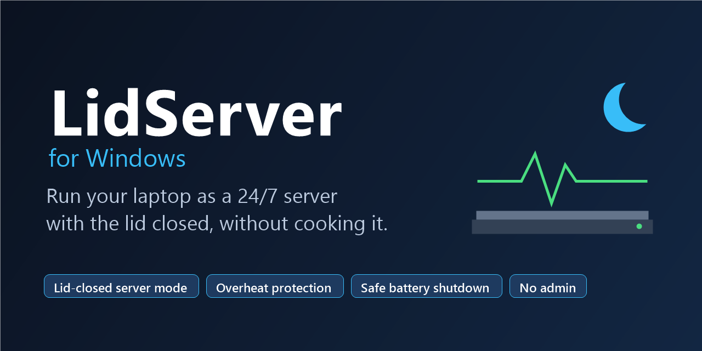

<p align="center">
  
</p>

# LidServer for Windows

**Run a Windows laptop as a 24/7 home server with the lid closed, without cooking it.**
LidServer keeps the laptop awake, freezes background apps when you close the lid, watches the
temperature, shuts down cleanly before the battery dies, and gets your bots running again after
a reboot. Think of it as an **Amphetamine / InsomniaX alternative for Windows**, built for
people who run trading bots, Discord bots, scrapers or self-hosted services on an old laptop
instead of paying for a VPS.


- **No install, no admin rights, no background service.** Plain PowerShell scripts you can read.
- **Nothing to download from strangers.** No exe, no driver, no telemetry.

## Why this exists

I stopped paying for a VPS and moved my bots (21 demo trading bots, 3 MetaTrader 5 terminals
and a Discord bot) to my gaming laptop until I can buy a mini PC. macOS has apps that keep a
closed laptop running safely. On Windows I only found "keep awake" tools, and none of them
protect the laptop when it gets hot, the power cable falls out, or you close the lid while
Chrome and Steam are still running. So I wrote LidServer.

## Features

| | What LidServer does |
|---|---|
| **Lid-closed server mode** | Close the lid and background apps (Chrome, Discord, Steam, ...) are frozen, the display turns off and audio is muted. Your bots keep running. Open the lid and everything comes back. |
| **Overheat protection** | Alert at 80 C. At 88 C background apps are frozen until the laptop cools to 70 C. At 95 C for 3 minutes the laptop hibernates instead of damaging itself. |
| **Safe low-battery shutdown** | Power cable out? Alert at 20 %, clean Windows shutdown at 15 %, so files and databases are not corrupted when the battery dies. |
| **External monitor aware** | Working at your desk with the lid closed and a monitor plugged in? Server mode stays off, so your apps don't freeze. |
| **Never sleeps** | A power plan that never sleeps on AC, ignores the lid on AC and turns CPU turbo off to keep temperatures low. |
| **Self-healing** | Starts at logon from Task Scheduler and restarts itself within 5 minutes if it ever dies. |
| **Logs and reports** | One temperature/CPU/battery/lid reading per minute in a CSV, and a report that compares lid open vs lid closed. |
| **Discord alerts (optional)** | Paste a webhook URL and get heat, power and battery alerts on your phone. |
| **Load test** | Stress all CPU threads and see how hot your laptop gets, with an automatic stop before it is dangerous. |

## Real results

Measured on an MSI GF63 Thin (i7-10750H, GTX 1650) running 21 bots, 3 MetaTrader 5 terminals
and a Discord bot around the clock:

| Situation | Temperature |
|---|---|
| Normal load, about 16 % CPU | 45-65 C |
| Lid closed for 3 hours | average 53 C, max 65 C |
| Gaming with Steam open, no cooling pad | hit 88 C, LidServer froze background apps automatically |
| After adding a cooling pad | 80 C down to 47 C in 4 minutes |
| Power cable came out while away | ran about 2 h 15 min on battery |

## How it compares

| | Windows "lid: do nothing" | PowerToys Awake / Caffeine | **LidServer** |
|---|:-:|:-:|:-:|
| Keeps running with the lid closed | yes | no | **yes** |
| Freezes background apps on lid close | no | no | **yes** |
| Overheat protection with automatic action | no | no | **yes** |
| Clean shutdown before the battery dies | no | no | **yes** |
| Knows when you use an external monitor | no | no | **yes** |
| Restarts itself after a crash or reboot | - | no | **yes** |

[LidGuard](https://www.nuget.org/packages/lidguard) is another good option if you
only need to keep a closed laptop awake while an AI coding agent runs.

## Quick start

Requires Windows 10 or 11 (Windows PowerShell 5.1 is built in). No admin rights needed.

1. **Download** this repo: the green **Code** button, then **Download ZIP**. Unzip it somewhere
   permanent, for example `D:\lidserver-windows`.
2. **Open PowerShell in that folder** and allow local scripts for this session:
   ```powershell
   Set-ExecutionPolicy -Scope Process Bypass
   ```
3. **Create and switch to the power plan** (never sleep on AC, lid does nothing on AC, turbo off):
   ```powershell
   .\setup-power-plan.ps1 -Activate
   ```
4. **Check your laptop is supported.** Safe: nothing is paused or shut down.
   ```powershell
   .\tests\smoke-test.ps1
   ```
5. **Install the agent** (starts now and at every logon):
   ```powershell
   .\install.ps1
   ```
6. Close the lid. Check on it later with `server-status.cmd`.

## Daily use

| Double-click | What it does |
|---|---|
| `server-on.cmd` | Server mode now: freeze background apps, mute, display off |
| `server-off.cmd` | Bring everything back |
| `server-status.cmd` | Temperature, mode, and the last 24 hours split by lid open / closed |

Frozen apps show "Not responding" until they are resumed. That is expected. If one ever stays
frozen, run `server-off.cmd`; it also rescues stuck apps.

## Settings

Everything is in `config.json` and is re-read every minute, no restart needed.

| Setting | Default | Meaning |
|---|---|---|
| `thermal.warnC` | 80 | Alert |
| `thermal.pauseC` | 88 | Freeze background apps |
| `thermal.cooldownC` / `cooldownReadings` | 70 / 5 | Resume after 5 readings at or below 70 C |
| `thermal.criticalC` / `criticalReadings` | 95 / 3 | Hibernate after 3 readings at or above 95 C |
| `thermal.criticalAction` | `hibernate` | Set to `none` to only alert |
| `battery.lowPct` | 20 | Alert when unplugged |
| `battery.shutdownPct` | 15 | Clean shutdown when unplugged. Near empty, battery gauges drop fast (we saw 12 % to 6 % in one minute), so do not set this too low |
| `serverMode.pauseApps` | Chrome, Edge, Discord, Steam, Epic, Riot, ... | Process names to freeze. Python, MetaTrader, terminals, VS Code and Windows itself are never frozen |
| `lid.serverModeOnClose` | true | Turn server mode on when the lid closes |
| `alerts.discordWebhookUrl` | empty | Optional Discord webhook for alerts |

## Make your own bots survive a reboot

LidServer protects the laptop; your bots need to start by themselves too. What worked for us:

- Start each bot from **Task Scheduler** with an **At log on** trigger plus a trigger that
  **repeats every 5 minutes**, and set "If the task is already running" to **Do not start a new
  instance**. A dead bot is then back within 5 minutes, and a running one is left alone.
- Launch through `conhost.exe --headless powershell.exe -File your-bot.ps1`. A script started in
  a normal terminal window dies when that window is closed.
- Windows must sign in by itself after a power cut for logon tasks to run. That only happens on
  an account without a password or PIN. **This is a security trade-off**: anyone holding the
  laptop gets in, including your bots' API keys. Decide for yourself.

## Tip: cooling pad

A cooling pad made the biggest difference of anything we tried (80 C down to 47 C). If your pad
comes with its own control app and you don't trust it, block the app's internet access in
Windows Firewall. Fan control goes over USB and keeps working offline.

## Discord alerts

Alerts always go to `logs\agent.log`. To also get them in Discord: Channel settings,
Integrations, Webhooks, create one, and paste the URL into `alerts.discordWebhookUrl`. Treat
that URL like a password. Anyone holding it can post to your channel.

## Uninstall

```powershell
.\uninstall.ps1                  # stop the agent, resume frozen apps, remove autostart
.\setup-power-plan.ps1 -Remove   # delete the power plan (switch to another plan first)
```

Then delete the folder. Nothing else was changed.

## FAQ

### How do I keep my Windows laptop running with the lid closed?
Set "When I close the lid" to "Do nothing" for "Plugged in" (`setup-power-plan.ps1` does this
for you). The hard part is keeping a closed laptop **safe**: it traps heat, and apps you forgot
about keep burning CPU. LidServer freezes those apps and watches the temperature.

### Can I use an old laptop as a server instead of a VPS?
Yes, for bots, scrapers, home automation, game servers or small websites. You save the monthly
VPS bill. You need a stable home internet connection, a cooling plan, and a way for things to
restart after a power cut. LidServer handles the laptop side.

### Is it safe to leave a laptop on 24/7?
Laptops are built to run for long periods, but heat and a battery kept at 100 % age them
faster. Keep it under about 70 C most of the time (turbo off helps a lot), use a cooling pad,
and set a battery charge limit in your manufacturer's app if it has one (often 60-80 %).

### Why does my laptop overheat with the lid closed?
Many laptops pull air through the keyboard area or vent through the hinge, and the closed
screen blocks that. Background apps (browsers, game launchers) add load you don't see. Compare
lid open and lid closed temperatures with `server-status.cmd` after a day.

### Is there an Amphetamine or InsomniaX for Windows?
PowerToys Awake and Caffeine keep a Windows PC awake, but they don't handle the lid, heat or
battery. LidServer covers the "closed laptop as a server" case.

### Does it need admin rights or install a service?
No. It runs as your user from Task Scheduler. No exe, no driver, no service.

### What happens during a power cut?
On battery LidServer alerts you, and at 15 % it shuts Windows down cleanly. A laptop does not
power itself back on, so press the power button when the power returns. If Windows signs in
by itself, your logon tasks start again.

### Will my bots stop when server mode is on?
No. Only apps listed in `serverMode.pauseApps` are frozen. Python, MetaTrader 5, terminals,
VS Code and system processes are on a hard-coded never-freeze list.

### Why not just use Sleep?
Sleep turns the CPU off, so every bot stops. Server mode only *looks* asleep: screen off,
quiet, low power, but still running.

## Limits

- Runs only while you are signed in. After a reboot nothing runs until Windows signs in.
- The temperature comes from the ACPI thermal zone (no admin needed). It is one sensor, not
  per-core. `tests\smoke-test.ps1` tells you whether your laptop exposes it.
- Frozen apps keep their memory. Server mode saves CPU and heat, not RAM.
- **Start, Power, Sleep is still real sleep** and stops everything. Close the lid instead.
- Keep all `.ps1` files ASCII only. Windows PowerShell 5.1 misreads other characters.

## Credits

Inspired by [Insomnia](https://github.com/krishhgg/Insomnia) and Amphetamine for macOS.

## License

[MIT](LICENSE). Use it, change it, share it.
